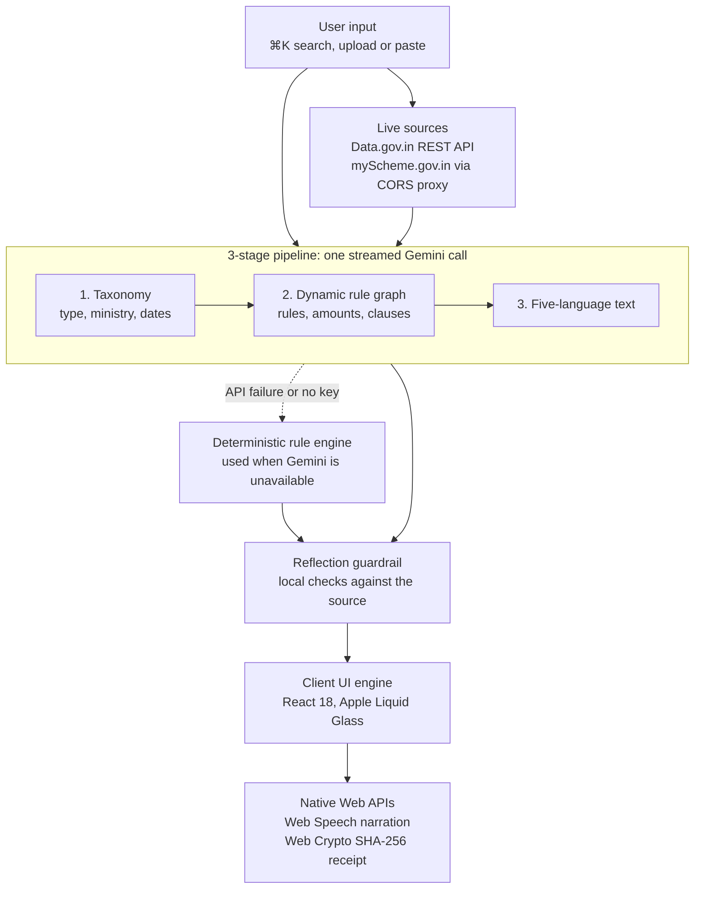

<div align="center">

# JanSetu AI — Next-Generation Civic Intelligence Engine

*Decoding India’s Complex Welfare Schemes, Gazette Notifications & Municipal Bylaws into Plain-Language Regional Voice, Dynamic Simulators & SHA-256 Citizen Receipts.*

[](https://thedevagarwal09.github.io/jansetu-ai/)
[](https://react.dev)
[](https://tailwindcss.com)
[](https://ai.google.dev)
[](https://developer.mozilla.org/en-US/docs/Web/API/Web_Crypto_API)
[](LICENSE)
[](#key-innovations)

**[Live Demo](https://thedevagarwal09.github.io/jansetu-ai/)** • **[Demo Video](https://youtu.be/0aTyTFqn6UU)** • **[Slide Deck (PDF)](JanSetu_AI_Pitch_Deck.pdf)** • **[Architecture](#system-architecture--data-flow)** • **[Rubric Alignment](#hackathon-rubric-alignment)**

</div>

---

## The Problem vs. Our Solution

| India’s statutory maze | JanSetu AI |
| :--- | :--- |
| **Bureaucratic jargon.** Gazette orders and bylaws are written for officials, so citizens struggle to tell whether an income, turnover or age limit applies to them. | **Plain-language citizen cards.** Each document becomes benefits, eligibility, a checklist and next steps, with limits turned into a live “Do I Qualify?” check. |
| **English-first exclusion.** About 10.6% of Indians reported speaking English, and literacy was 74.04% in Census 2011, so text-only English portals leave many people out. | **Five languages, read aloud.** English, हिन्दी, বাংলা, తెలుగు and தமிழ், with spoken narration and a highlighted transcript. |
| **DBT payment failures.** An eligible citizen’s payment can still bounce if Aadhaar is not mapped to their bank account on the NPCI mapper. | **Guided DBT diagnostic.** A four-question self-check shows the likely gap and the exact fix, with bank and payment portal links. |
| **Scattered rules and middlemen.** Rules sit across central, state and municipal sources, and the information gap lets middlemen charge illegal “approval fees”. | **Four document streams with a trust layer.** One hub for all four types, a ₹0 fee warning on welfare schemes, and direct links to official grievance channels. |

## 4-Stream Statutory Ingestion Spectrum

| Stream | Built-in examples | Detail page cards | Dedicated action |
| :--- | :--- | :--- | :--- |
| 🏛️ **Welfare Schemes** (DBT & subsidies) | PM-Kisan, PM Surya Ghar, Post-Matric Scholarship, PM Vishwakarma and more | Benefits • Eligibility • Document checklist • Filing roadmap | Zero-Fee Anti-Bribery Shield, DBT help |
| 📜 **Regulatory Gazette Notifications** (amnesties & penalty waivers) | Rajasthan Amnesty Scheme 2026 | Relief & waivers • Affected entities • Compliance checklist • Filing window & authority | Deadline pill read from the document |
| 🏙️ **Municipal Bylaws** (waste & local rules) | Bengaluru Solid Waste Management Bye-laws, 2020 | Fees & fines • Jurisdiction • Inspection checklist • Notice rights & appeal | Know Your Rights & Notice Shield |
| 📝 **Draft Policies for Public Consultation** (EV infrastructure) | NITI Aayog Draft Battery Swapping Policy | Proposed incentives • Stakeholders • Key clauses • Feedback window | Editable public feedback letter |

Any PDF, DOCX or TXT can be analysed in the Document Studio, with its type auto-detected or chosen by the user. Live records can also be pulled from the Open Government Data Platform India.

## System Architecture & Data Flow



**How a document is processed**

1. **Input.** The user searches with ⌘K, uploads a file, pastes text or loads a live record.
2. **Reading.** Files are read in the browser with pdf.js and mammoth.js. There is no server of our own.
3. **Gemini call.** A single streamed request returns schema-enforced JSON. The three stage markers advance as each part of the response arrives.
4. **Guardrail.** Local code checks the portal domain, helpline, email, deadline, amounts and rule quotes against the source. Anything unsupported is removed and logged in the card’s trace.
5. **Failover.** A 503 is retried once, then the next model is tried. If every model fails or no key is set, the rule engine builds an English card and the trace says why.

## Key Innovations

| Feature | What it does |
| :--- | :--- |
| **“Do I Qualify?” Dynamic Rule Simulator** | Turns clauses into switches and income or age inputs, with a live 0–100% readiness score and a list of what is still missing. For bylaws and policies, any one match means the document applies. |
| **Control Center Voice Engine** | Browser voices by default, with optional Gemini voices. English offers male and female; regional languages use a female voice. Includes speed control, seeking and a highlighted transcript. Available voices depend on the browser, and Microsoft Edge offers the most. |
| **Civic Trust & Anti-Exploitation Shield** | A ₹0 fee warning on welfare schemes, links to CPGRAMS and Helpline 14555 (National Health Authority, PM-JAY), a Central Vigilance Commission link, and a DBT / NPCI seeding self-check. |
| **SHA-256 Citizen Receipts** | `JS-SHA256-…` reference IDs made with the Web Crypto API, from the document, the time and the readiness score. They work offline. The inputs are not stored, so a receipt cannot be independently re-verified later. |
| **Public Feedback Letters** | An editable letter citing a draft’s proposed clauses, ready to copy, or to open in email when the source states an address. |
| **Low-Connectivity Sharing** | WhatsApp links sized to work with Indian-language text, and a plain-text brief that can be read offline. |

## Technical Stack & API Specifications

| Layer | Technology | Purpose |
| :--- | :--- | :--- |
| UI | React 18.3.1, Babel Standalone 7.24.7 | Multi-page client router, compiled in the browser with no build step |
| Styling | Tailwind CSS 3.4.5 (CDN) | Apple Liquid Glass design system |
| Icons | Lucide React 0.263.1 | Interface icons |
| Document reading | pdf.js 3.11.174, mammoth.js 1.6.0 | Loaded only when a PDF or DOCX is uploaded |
| Speech | Web Speech API | Default narration |
| Receipts | Web Crypto API | SHA-256 receipt IDs |

| Service | Endpoint | Details |
| :--- | :--- | :--- |
| Google Gemini (text) | `generativelanguage.googleapis.com/v1beta` | `gemini-3.5-flash-lite` → `gemini-3.1-flash-lite` → `gemini-flash-lite-latest` → `gemini-3.5-flash`. Key sent in the `x-goog-api-key` header. |
| Google Gemini (optional voices) | Same API | `gemini-3.8-flash-tts` → `gemini-3.1-flash-tts-preview` → `gemini-2.5-flash-preview-tts` |
| Open Government Data Platform | `api.data.gov.in` | `/lists` to search resources, `/resource/{id}` for records. Uses the public sample key unless you add your own. |
| myScheme.gov.in | Via `api.allorigins.win` | Best-effort page read, skipped if the proxy fails. The portal renders scheme data in the browser, so cards usually come from Gemini using the scheme name, and they say so. |

**Measured performance:** a one-page document produced a five-language card with one Gemini request and about 2,400 tokens, in 6–18 seconds depending on Google’s load.

## Local Setup & Deployment

There is nothing to install or build. You need an internet connection for the CDN libraries and live APIs.

**Python**

```bash
git clone https://github.com/thedevagarwal09/jansetu-ai.git
cd jansetu-ai
python3 -m http.server 8765
```

Then open <http://localhost:8765>.

**Node.js**

```bash
git clone https://github.com/thedevagarwal09/jansetu-ai.git
cd jansetu-ai
npx serve -l 8765
```

**Adding a Gemini key**

No key is included in this repository. To enable live AI:

1. Create a key at [Google AI Studio](https://aistudio.google.com/apikey).
2. Select **Add Gemini key** at the top of the app, paste it, choose **Test Gemini**, then **Save**.

The key is stored only in your browser. Without one, the app still works with its built-in documents, the rule engine and browser voices.

**Deploying**

Serve the repository root from any static host. For GitHub Pages, open **Settings → Pages** and publish the `main` branch from the root folder.

## Hackathon Rubric Alignment

Targets are our own assessment; the final scores are the judges’ decision.

| Pillar | Target | How JanSetu AI addresses it | Where to verify |
| :--- | :--- | :--- | :--- |
| **Technical Architecture & Engineering Depth** | 20/20 | Single-file app with no build step or backend, a client-side router, and native Web Crypto and Web Speech APIs | `index.html` |
| **AI Reasoning & Agentic Execution** | 25/25 | Three-stage streamed pipeline, schema-enforced JSON, dynamic rule objects, source-checking guardrail, multi-model failover | Agent pipeline trace on any Studio card |
| **Problem Relevance, Impact & USP** | 25/25 | Four document streams, five languages with voice, DBT diagnostic, anti-bribery shield, feedback letters | Catalog and Grievances pages |
| **Live Demonstration & Robustness** | 30/30 | Live Gemini and Data.gov.in calls, no fabricated documents, graceful fallback when an API fails | [Live demo](https://thedevagarwal09.github.io/jansetu-ai/) |

## Known Limitations

- Built-in document summaries come from public and partly secondary sources, and each links to its source. Always confirm details on the official portal before acting.
- Only the first 12,000 characters of a document are sent to Gemini.
- The guardrail checks figures, dates, contacts and rule quotes; it does not check every sentence of a card.
- Rule-engine cards are English-only, and some checklist and clause items stay in English.
- Free Gemini keys have low daily limits.

JanSetu AI is an independent explainer, not an official Government of India website.

## Engineering Team & Code Ownership

Built at the **Indian Institute of Information Technology, Allahabad (IIIT-A)** by First-Year B.Tech undergraduates, using AI-assisted development.

| Member | Role |
| :--- | :--- |
| **Dev Agarwal** | Lead AI & Agentic Systems Architect |
| **Shaurya Tyagi** | Full-Stack & Apple Design Systems Engineer |
| **Ishit Goyal** | Civic Data, Security & Core Infrastructure Engineer |

## License

Released under the [MIT License](LICENSE).
